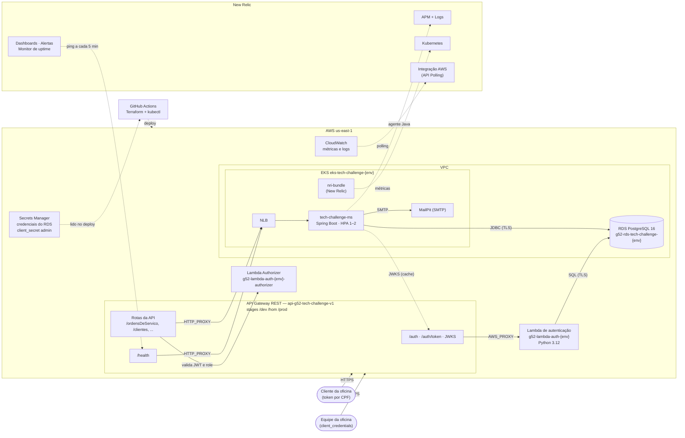

# Arquitetura — G52 Tech Challenge (Fase 3)

Documentação arquitetural da solução: visão de componentes, fluxos principais e o registro das decisões técnicas.

| Documento | Conteúdo |
|---|---|
| [Diagrama de componentes](#diagrama-de-componentes) | Nuvem, APIs, banco e monitoramento (abaixo) |
| [Diagramas de sequência](sequencias.md) | Autenticação (CPF e `client_credentials`) e abertura de ordem de serviço |
| [RFCs](rfcs/) | Propostas técnicas discutidas: nuvem, banco de dados e estratégia de autenticação |
| [ADRs](adrs/) | Decisões arquiteturais permanentes: comunicação, HPA, ambientes, segredos, observabilidade e autorização |
| [Modelo de dados](https://github.com/Teplotax/g52-infra-rds-tech-challenge/blob/main/docs/modelo-de-dados.md) | Justificativa do banco, diagrama ER, relacionamentos e ajustes no modelo (repositório `g52-infra-rds-tech-challenge`) |

## Visão geral

A oficina expõe uma API REST de gestão de ordens de serviço (OS). Toda chamada externa entra pelo **API Gateway**:

- `POST /auth` e `POST /auth/token` vão para a **Lambda de autenticação**, que valida o cliente (CPF) ou a credencial da equipe (`client_credentials`) e emite um JWT.
- As demais rotas passam pelo **Lambda Authorizer**, que valida o JWT e a role, e são encaminhadas para a **aplicação Spring Boot** no **EKS**, que persiste no **RDS PostgreSQL**.
- **New Relic** recebe APM, logs, métricas do cluster e da AWS, e concentra dashboards, alertas e o monitor de uptime.
- Tudo é provisionado com **Terraform** e publicado por **GitHub Actions** em três ambientes (`dev`, `hom`, `prod`).

## Diagrama de componentes

| Componente | Repositório | Responsabilidade |
|---|---|---|
| API Gateway (REST API e role de logs da conta) | `g52-infra-gateway-tech-challenge` | API única, compartilhada pelos três ambientes |
| Contrato OpenAPI e stages | `g52-api-tech-challenge-v1-ext` | Rotas, integrações e *stage variables* de cada ambiente |
| Lambda de autenticação e Authorizer | `g52-lambda-tech-challenge` | Emissão (CPF e `client_credentials`) e validação dos JWT |
| Cluster Kubernetes | `g52-infra-eks-tech-challenge` | EKS, autoscaling, ECR, New Relic (Kubernetes, dashboards e alertas) |
| Banco de dados | `g52-infra-rds-tech-challenge` | RDS PostgreSQL, SG de clientes e credenciais |
| Aplicação | `g52-app-tech-challenge` | API Spring Boot, manifestos Kubernetes e migrations Flyway |
| Documentação da API | `doc-api-tech-challenge-v1` | Swagger publicado no GitHub Pages |
