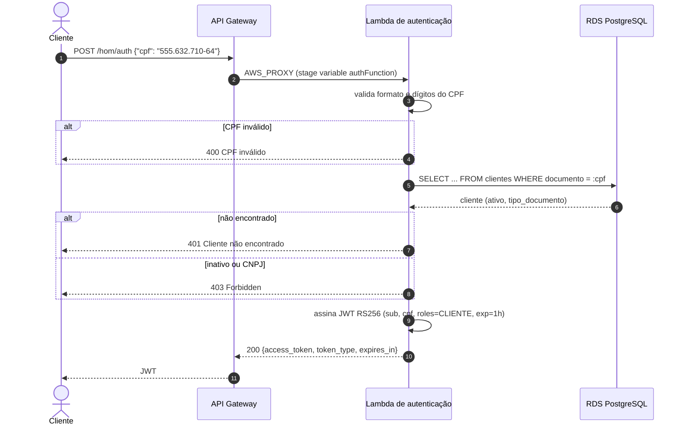
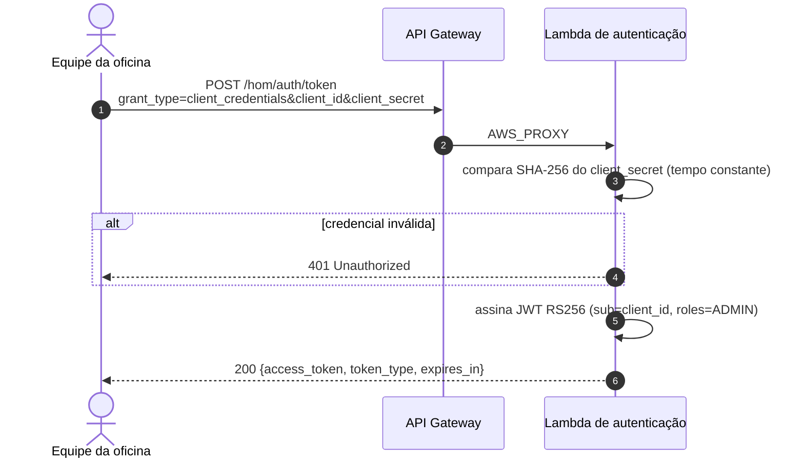
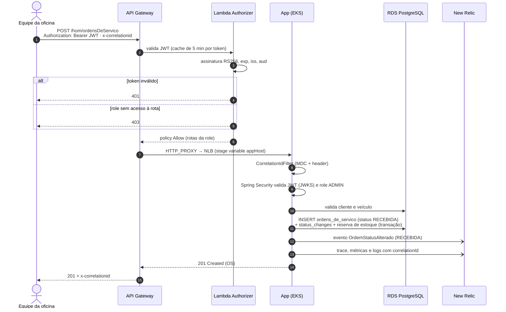
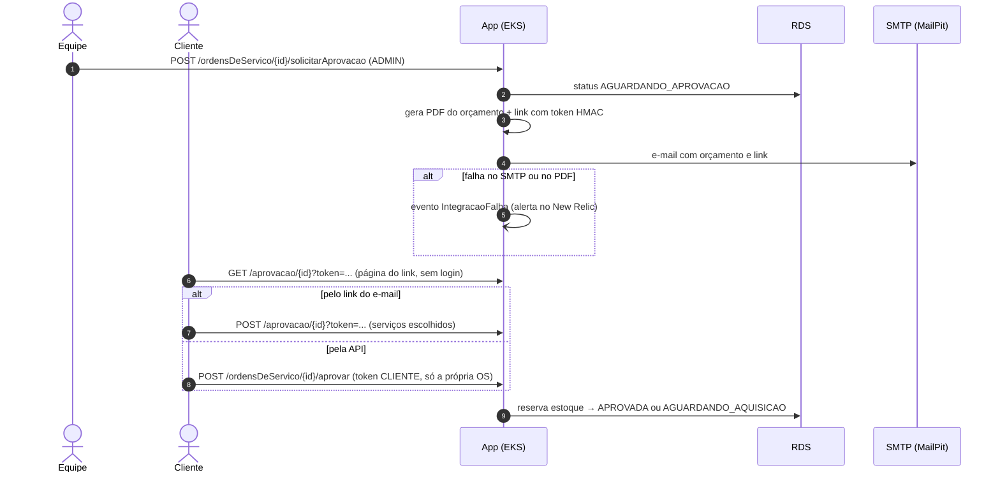

# Diagramas de sequência

## 1. Autenticação do cliente por CPF

O cliente informa o CPF e recebe um JWT com `roles: ["CLIENTE"]`, que só permite consultar e aprovar as próprias OS.

## 2. Autenticação da equipe (`client_credentials`)

A equipe da oficina usa o grant OAuth2 `client_credentials` e recebe um JWT com `roles: ["ADMIN"]`, que acessa todas as rotas.

## 3. Abertura de ordem de serviço

A equipe abre uma OS com o token administrativo. O Gateway valida o token antes de chegar ao cluster, e a aplicação valida de novo (defesa em profundidade).

## 4. Aprovação do orçamento pelo cliente

